# Claude 3D Film Studio

**Turn Claude into a 3D film studio. One brief becomes a frame-exact, cinematic 40-second Three.js explainer film, made with real scientific and engineering assets, music and SFX.**

<table>
  <tr>
    <td><a href="examples/ev-motor.md">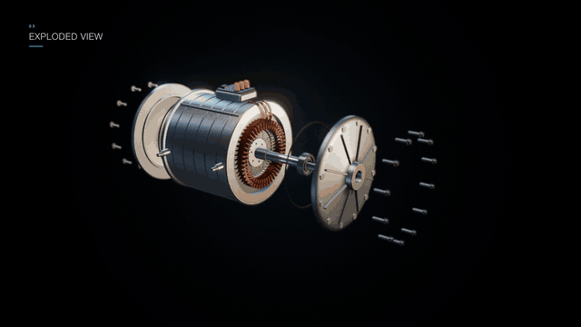</a></td>
    <td><a href="examples/human-anatomy.md">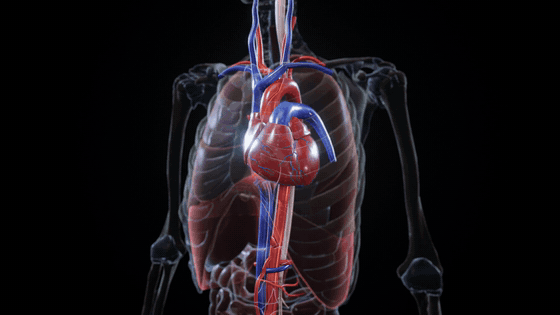</a></td>
    <td><a href="examples/mounjaro-tirzepatide.md">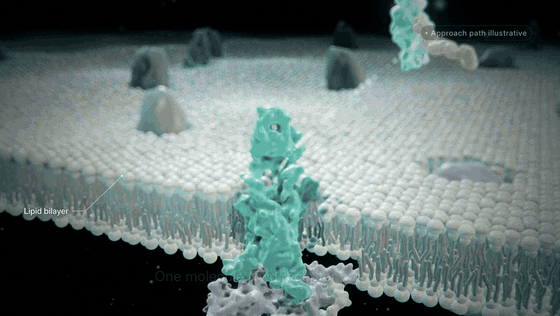</a></td>
  </tr>
  <tr>
    <td align="center"><b>How an EV motor works</b><br>procedural engineering · 1200 frames</td>
    <td align="center"><b>The human body, system by system</b><br>Z-Anatomy / BodyParts3D · 1200 frames</td>
    <td align="center"><b>Tirzepatide, dual-receptor MOA</b><br>RCSB PDB cryo-EM + BodyParts3D · 1200 frames</td>
  </tr>
</table>

This is a Claude skill. You give it a brief, for example *"40 seconds, how a jet engine works"* or *"the mechanism of action of this drug"*. Claude then does the whole job:
1. Locks the timeline.
2. Builds or fetches **real, licensed assets**.
3. Writes a **deterministic** Three.js film, where every pixel is a function of the frame number.
4. Renders **exactly 1200 frames** through headless Chrome and ffmpeg.
5. Mixes music and SFX to −14 LUFS.
6. Hands back a validation report with the evidence.

Everything here comes from three films made end to end this way. The pitfalls they hit are written into the recipes.

---

## What it makes

| | |
|---|---|
| **Format** | 40.000 s · 1200 frames · 1920×1080 · 30 fps · H.264, verified by decoding (any length/size works) |
| **Engineering** | motors, turbines, engines, gearboxes, batteries, valves: procedural geometry, exploded views, cut-aways, synchronised physics |
| **Anatomy** | full-body systems from Z-Anatomy / BodyParts3D (CC BY-SA), aligned GLBs, beating heart, breathing lungs, blood flow on real vessel centre-lines |
| **Molecules** | receptors, proteins and peptides from RCSB PDB cryo-EM/X-ray structures as smooth surfaces, with the PDB ID on screen |
| **Look** | procedural studio light, rim lighting, tissue SSS approximation, GTAO, DOF rack focus, bloom, ACES grade, glass-panel labels |
| **Sound** | licensed music bed and SFX hits placed on the timeline, measured at −14 LUFS |
| **Proof** | stills you look at, a determinism `cmp`, decode-verified frame count, a 15-point validation report, a second-model science review |

## The three films

| Film | Assets | Render | Read |
|---|---|---|---|
| **How an EV motor works**: hero, labelled internals, exploded view, three-phase field, cross-section, high-speed cooling | 100 % procedural PMSM: 48-slot stator, 192 hairpins, 64 magnets, bearings, bolts | 1200 frames in 12 min | [examples/ev-motor.md](examples/ev-motor.md) |
| **The human body**: skin scan, systems, exploded anatomy, heart/lungs/nerves, capillary micro-journey | Z-Anatomy: 22 GLBs, 1626 nodes, 3.16 M triangles | 1200 frames in 10.5 min | [examples/human-anatomy.md](examples/human-anatomy.md) |
| **Tirzepatide, dual-receptor MOA**: pen → skin → blood → receptors → organs | PDB 7FIY / 7FIM cryo-EM + BodyParts3D | 1200 frames | [examples/mounjaro-tirzepatide.md](examples/mounjaro-tirzepatide.md) |

| | | |
|---|---|---|
| 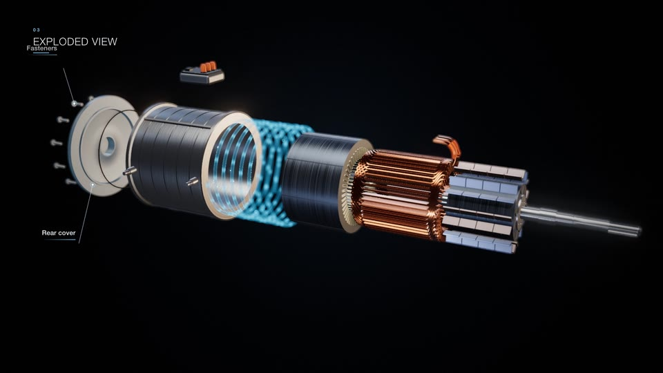 | 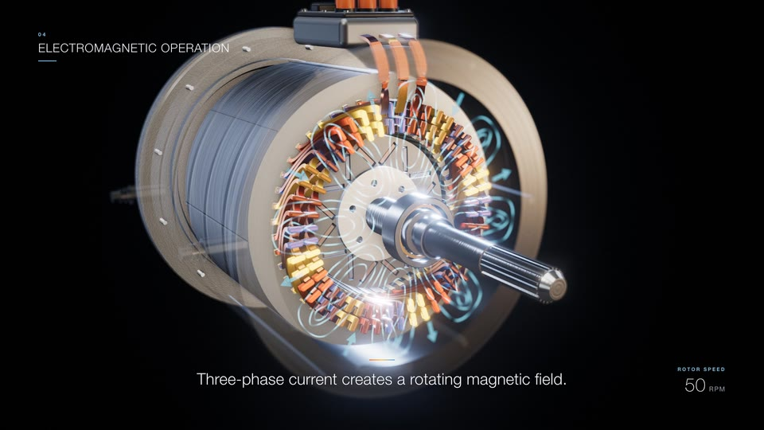 | 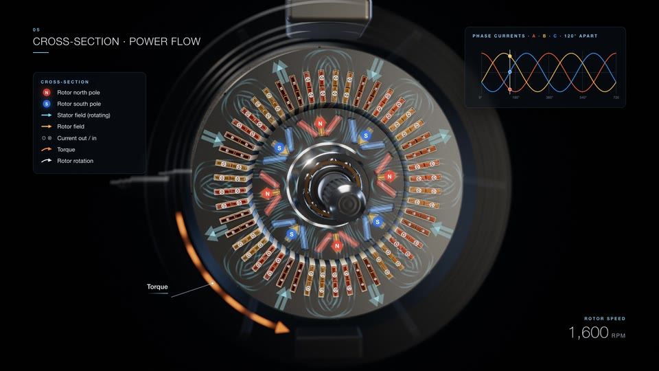 |
| 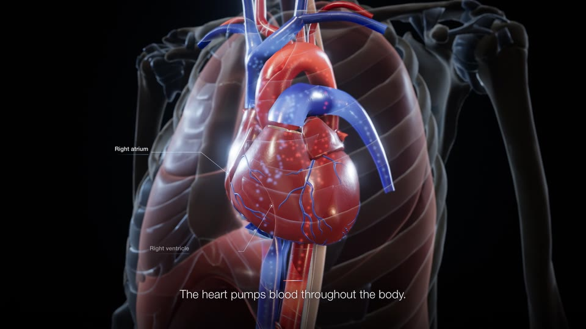 | 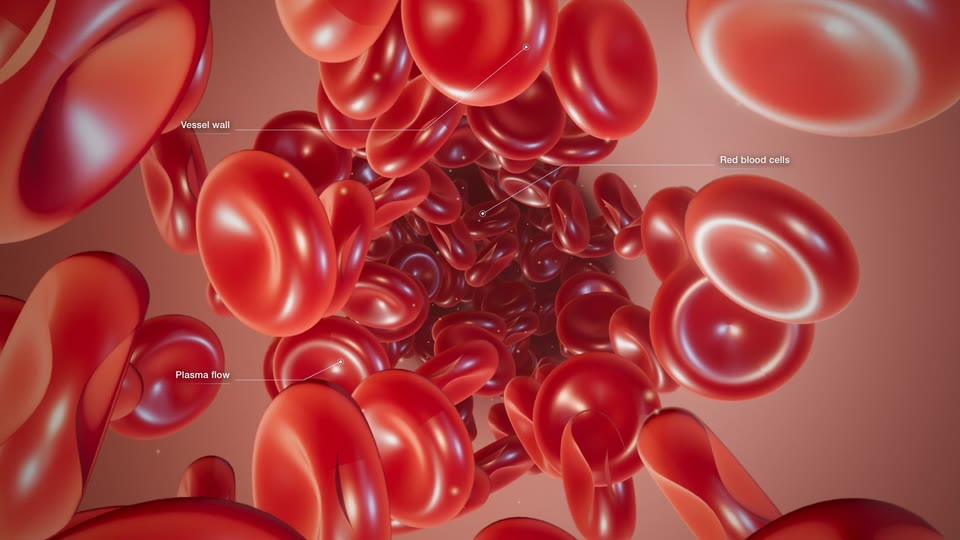 | 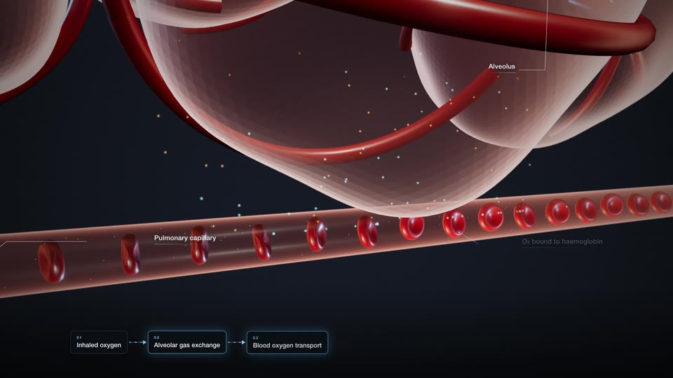 |
| 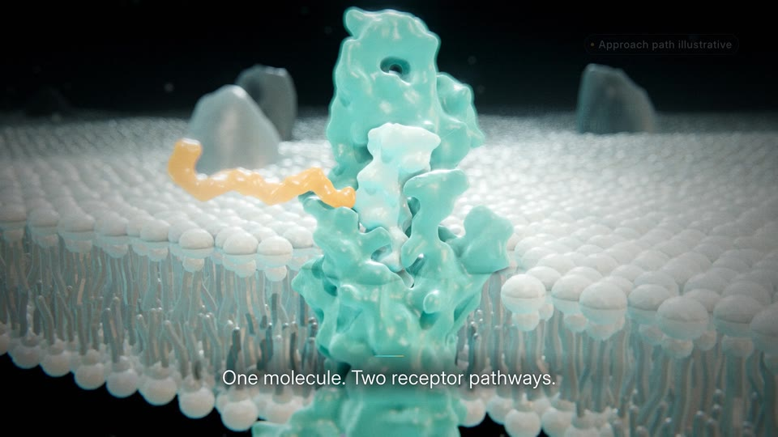 | 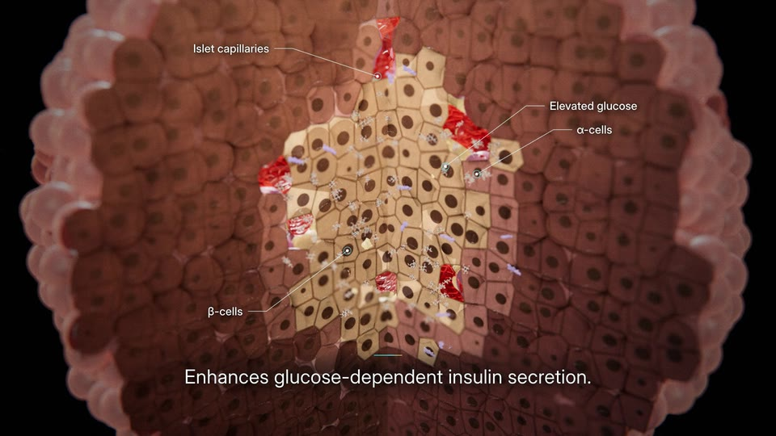 | 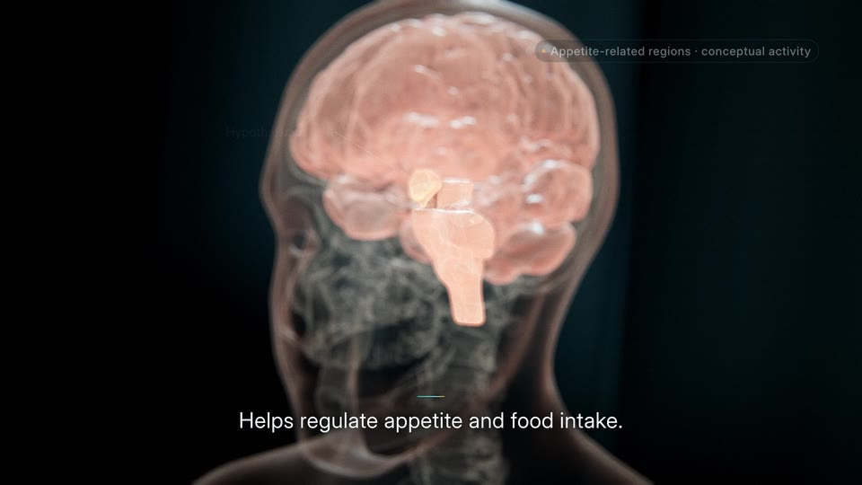 |

---

## Install in 30 seconds

1. Download this repository (**Code → Download ZIP**) and unzip it.
2. Copy the folder into `~/.claude/skills/` (for every project) or `<project>/.claude/skills/` (for one project), and name it `claude-3d-film-studio`.
3. Ask Claude Code for a film. The skill loads by itself on prompts like *"3D animation"*, *"Three.js film"*, *"medical 3D"* or *"exploded view of…"*.

What you need:

| For | Install |
|---|---|
| Everything | Node 18+, Google Chrome (or Chromium), `ffmpeg` on PATH |
| Anatomy assets | Blender 4.x (headless; for converting FBX/OBJ into GLB) |
| Molecular assets | Python 3 + `numpy scipy scikit-image trimesh gemmi fast-simplification` |

Try the runnable starter first. It renders a 5-second, 150-frame demo:

```bash
cd templates && npm install && npm run stills && npm run render
# → out/film.mp4   verify: frames=150 (expected 150) duration=5.000s (expected 5.000s) → OK
```
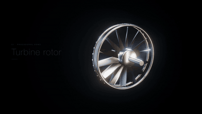

---

## Example prompts

> *Make a 40-second cinematic Three.js explainer of how a turbofan works. Exactly 1200 frames at 30 fps, 1920×1080. Procedural fan, compressors, combustor, turbines and two shafts. Exploded view at 11–19 s, bypass and core airflow, a cut-away at 38 s. End line: "Suck. Squeeze. Bang. Blow." Music and SFX.*

> *40 s medical film of how the aortic valve opens and closes, using the BodyParts3D heart (credit at the end). One 72 bpm clock drives the cusps, the flow particles and a pressure-curve panel. Write a validation report and have a second model review the science.*

> *Make a mechanism-of-action film for a GLP-1 receptor agonist across four scales, with the receptor taken from PDB 7FIM and its ID shown on screen. Label invented geometry as conceptual. No brand names and no efficacy numbers.*

There are 14 more in [prompts/example-prompts.md](prompts/example-prompts.md): disc brake, Li-ion cell, DNA replication, lungs, differential, wind turbine, knee, vaccine, and your own product's GLB.

---

## How it works

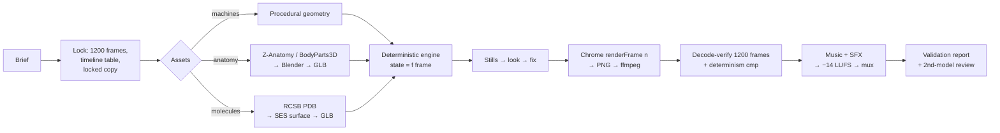

```
claude-3d-film-studio/
  SKILL.md                     router + the 10-step pipeline + house rules
  recipes/
    brief-and-timeline.md      lock frames, timeline table, copy, real vs conceptual
    assets-engineering-procedural.md   lathe/extrude/sweep parts, explode tables, synced physics
    assets-anatomy-z-anatomy.md        Z-Anatomy/BodyParts3D → aligned GLBs, licences, gotchas
    assets-molecules-pdb.md            PDB → SES surfaces, membrane frame, conceptual parts
    deterministic-engine.md    renderFrame contract, seeded random, Hermite tracks, ghost layers
    frame-exact-render.md      puppeteer-core + system Chrome + ffmpeg, verify, determinism
    cinematic-look.md          light rig, tissue SSS, post chain, camera language, labels
    audio-music-sfx.md         spotting hits, amix/loudnorm gotchas, measuring
    qc-and-delivery.md         stills loop, 15-point validation, second-model review, gallery
  templates/                   runnable starter (npm run render → 150 verified frames) + scripts/
  examples/                    the three films: brief, timeline, assets, numbers, pitfalls
  prompts/example-prompts.md   copy-paste briefs
  gallery/                     stills and GIFs from the delivered films
```

### What makes it different

- **Frame-exact by construction.** Each frame is rendered on its own (`window.renderFrame(n)`) and screenshotted, and ffmpeg encodes exactly N frames. The result is verified by decoding, not by trusting metadata. Two renders of the same frame are byte-identical.
- **Real assets with licences.** Real anatomy datasets, real PDB structures and engineered geometry, each with a manifest, and the credit goes on screen. Anything invented is labelled *conceptual*.
- **Cinematic is a gate.** A plain-viewer look fails review. The recipes give the light, shader, post and camera values that passed.
- **It checks its own work.** Stills it looks at, camera-jump checks, explode-returns-home checks, loudness measurement, and a second model reviewing the science.

---

## Credits and licences

Created by **Maged El-Gohary**. The method, recipes, starter code and scripts are original work made with Claude Code, released under the [MIT License](LICENSE).

**No third-party asset files are included in this repository**: no GLB, FBX, OBJ, PDB or textures. The scripts fetch and build them on your machine, under each source's own licence:

| Source | Licence | You must |
|---|---|---|
| [Z-Anatomy](https://github.com/LluisV/Z-Anatomy) models (z-anatomy.com) | CC BY-SA 4.0 | credit on screen + in docs; ShareAlike on derived meshes |
| [BodyParts3D](https://dbarchive.biosciencedbc.jp/en/bodyparts3d/), © The Database Center for Life Science (DBCLS) | CC BY-SA 2.1 JP | "BodyParts3D, (c) The Database Center for Life Science licensed under CC Attribution-Share Alike 2.1 Japan" |
| [RCSB PDB](https://www.rcsb.org) / wwPDB structures | CC0 1.0 | nothing required; cite the primary paper and show the PDB ID |
| [OPM](https://opm.phar.umich.edu) membrane orientations | free for academic / non-commercial use | cite Lomize et al., *NAR* 2012 |
| Music and SFX | the licence of wherever you get them | use only tracks you are allowed to publish |

The gallery stills and GIFs are frames from the three delivered films. The anatomy frames come from its social-safe cut. Those films use Z-Anatomy / BodyParts3D models (CC BY-SA 4.0 / 2.1 JP), so the anatomy images are shared under CC BY-SA 4.0 with that credit.

Built on [three.js](https://threejs.org) (MIT), [Puppeteer](https://pptr.dev) (Apache-2.0), [ffmpeg](https://ffmpeg.org), [Blender](https://www.blender.org), [gemmi](https://gemmi.readthedocs.io), [scikit-image](https://scikit-image.org), [trimesh](https://trimesh.org).

Use it, fork it, make films with it. A mention is appreciated.
