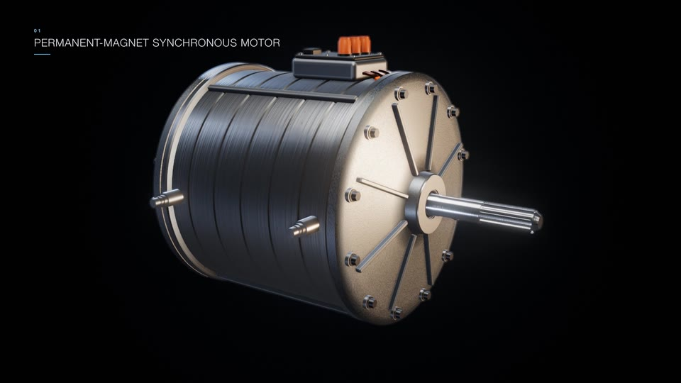
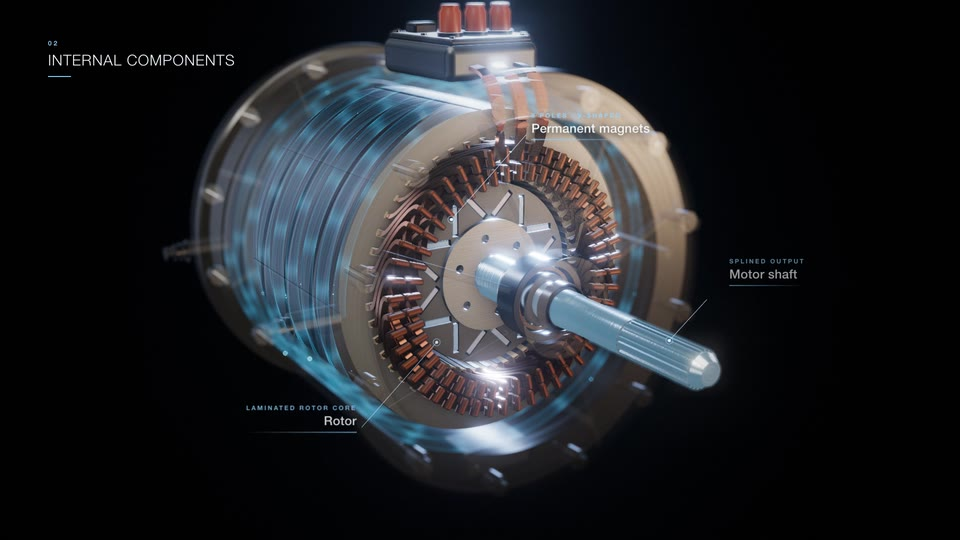
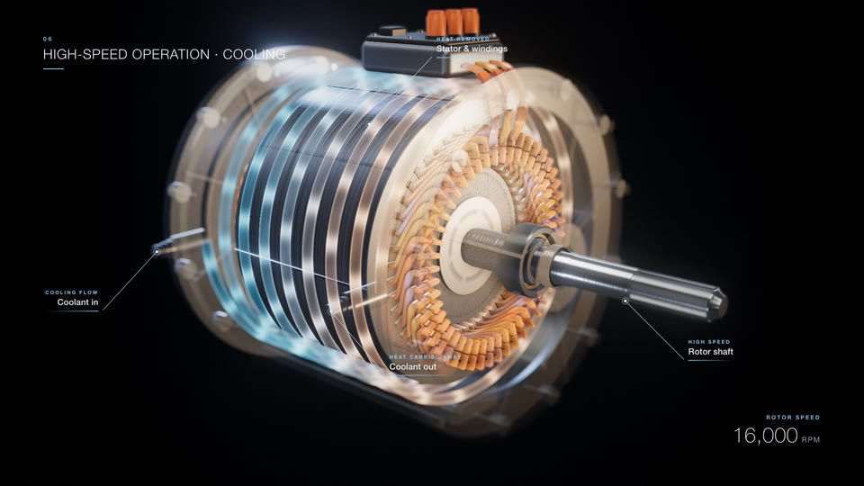

# Example: How an EV motor works (40 s, procedural engineering)

## The brief (summarised)

The brief asked for a premium, cinematic explainer of a Tesla-style permanent-magnet AC motor (PMSM), **with no logos or branding**, at exactly 40.0 s, 1920×1080, 30 fps and 1200 frames. Required looks: PBR brushed aluminium, copper, steel and magnets, with AO, shadows and subtle DOF. Camera: smooth orbits, dolly-ins, an exploded fly-through and a cross-section. No shake and no cuts. It also needed three exact captions and an exact end line. The film had to be a **repeatable benchmark**: the same timeline on every run.

## Timeline

| s | Beat | What made it work |
|---|---|---|
| 0–5 | Hero orbit in a dark studio; housing and front cover fade to ghost from 3.4–5 s | rim-heavy rig, gradient backdrop, turned-metal streaks |
| 5–11 | Dolly in; **9 parts highlighted one at a time**, 0.62 s apart, with labels, others dimmed to 45 % | label with kicker ("Laminated core · 48 slots") + leader line |
| 11–19 | **Exploded view** along the axis with a staggered start (bolts first, shaft last), magnets also split radially, camera flies through; reassembly from 17.4 s | one `EXPLODE` table `[delay, returnDelay]` per part; 14 small labels pulse as parts arrive |
| 19–28 | Three-phase current pulses in the copper, rotating field lines, attraction/repulsion cues, rotor accelerates; 3 captions | every value from one electrical angle → always synchronous |
| 28–34 | Head-on cross-section: N/S badges, ⊙/⊗ in 48 slots, stator/rotor field arrows, torque arc, A/B/C sine panel with cursor, 6-step energy chain | glass panels, legend, the chain builds one chip at a time |
| 34–38 | High speed (illustrative 16,000 rpm readout), **deterministic motion blur** (up to 14 sub-frames), coolant flowing through the helical jacket, heat fading from the copper | warm-to-cool coolant shader, heat uniform |
| 38–40 | Pull back to hero, quarter cut-away with section caps, spinning rotor, end text | wedge clipping planes + cap meshes |

## Assets

**All procedural; there is no external geometry.** The parts:
- Lathe-turned housing with grooves, ribs and coolant ports.
- Helical cooling jacket.
- Laminated stator with 48 slots and liners.
- 192 hairpin bars with welds and 3 busbars.
- Rotor with 8 V-pole pockets and 64 segmented magnets.
- Splined shaft.
- Two ball bearings: races, 11 balls each and a brass cage.
- Ribbed cast covers, 24 bolts, O-rings and a lip seal.
- HV terminal box.

Materials are MeshPhysicalMaterial with seeded canvas textures (turned aluminium, cast aluminium, lamination stripes, copper). The environment is a procedural PMREM made of soft boxes and strips. three.js 0.170.0. See `recipes/assets-engineering-procedural.md`.

Audio: a licensed music bed and 6 SFX (whoosh, explode, clunk, surge, spin-up, tick) placed on the timeline. Integrated loudness came out at about −13 LUFS and TP −0.8, from a single loudnorm pass.

## Numbers

- Render: **719.9 s for 1200 frames** (about 0.6 s per frame; the motion-blur section is slower) on an Apple M3 Pro, ANGLE/Metal.
- Decode check: `frame= 1200 … time=00:00:40.00`, `1920x1080, 30 fps`. The master is 62.5 MB at CRF 16.
- Determinism: frame 600 rendered twice, plus frames 1080/330/600 rendered in a different order, were byte-identical (SHA-256 matched).

## Pitfalls hit (and fixes)

- **A vertical dark seam** came from NaN normals, which had two causes: zero-length edges in the extrude shapes, and the background being drawn into the GTAO/DOF override passes. The fix was clean shapes plus hiding the background and FX during override renders.
- **A clipping sliver** showed while the cut-away was still "closed". The fix was to push the plane constants to 1000 when the wedge is closed.
- Bloom was too strong (it blew out the cap faces), labels overlapped, and the rear bearing was hidden in the explode. All three were fixed after looking at the stills.
- Taste notes from the review: 19–28 s is visually busy, and the ghosted housing has a beige cast from the warm environment strip.

## Stills

| | | |
|---|---|---|
|  |  |  |
| 2.5 s hero orbit | 8 s labelled internals | 14 s exploded view |
|  |  |  |
| 21.3 s three-phase current + field | 30 s cross-section, legend, phase waves | 36 s high speed, coolant, heat |
