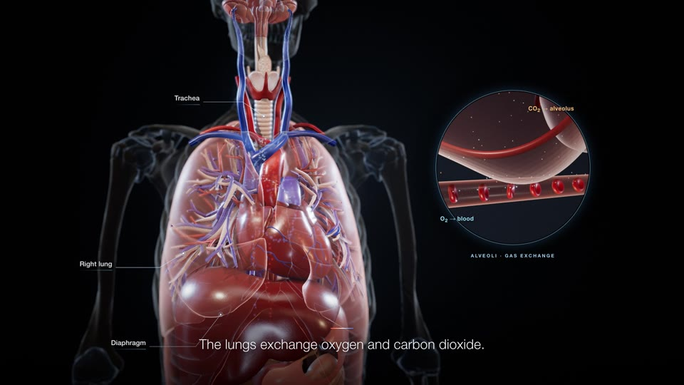
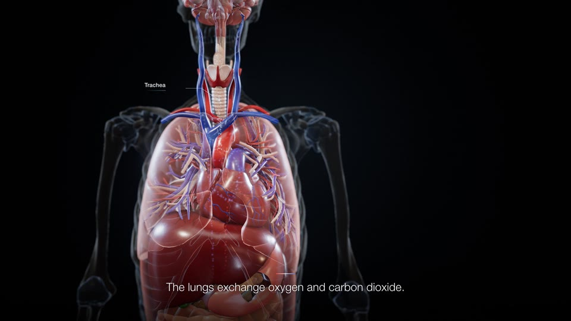
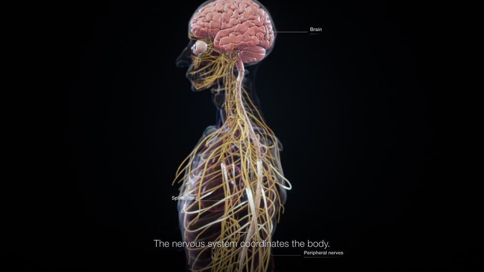

# Example: The human body, system by system (40 s, licensed anatomy)

The gallery images come from the **social-safe cut**, in which the external genitalia are blurred where the skin is opaque. The 3-D master itself is anatomically complete.

## The brief (summarised)

The brief asked for an extraordinary, cinematic and scientifically accurate journey through the human body, at exactly 40.0 s, 1920×1080, 30 fps and 1200 frames. It required PBR materials, SSS, cinematic light, DOF and deterministic animation. It had to include skin, subcutaneous tissue, muscles, skeleton, organs, nervous and circulatory systems with heart chambers, an exploded view, the living body (heart, lungs, nerves), a microscopic journey (RBCs, O₂ exchange), all systems working together, and a final hero shot. Exact captions were specified. It ruled out cartoon looks, low-poly anatomy and mannequin geometry.

## Timeline

| s | Beat | What made it work |
|---|---|---|
| 0–5 | Body emerges from darkness, slow ¾ orbit; title left via lens shift; **scan line** turns the skin into a Fresnel ghost from 2.5–4.75 s | skin opaque below the line, inner layers clipped below it |
| 5–11 | Layers reveal; 6 system labels (Muscular, Skeletal, Nervous, Cardiovascular, Respiratory, Digestive) highlighted in turn | ghost the occluders (the lungs hid the heart until fixed) |
| 11–19 | **Exploded anatomy**: systems separate into an arc, organs float forward, keeping their layout; dolly into the organ cluster; back home at 18.83 s | pure translations, AABB overlap check `[]`, offset after 19 s = 0 m |
| 19–28 | Heart close-up (RA/RV/LA/LV, 72 bpm, atria then ventricles, blood particles on real vessel centre-lines); lungs (4 s breath, diaphragm **down** on inhale, airflow); brain, cord, nerves with impulses | one physiology clock drives mesh, particles and shader pulses |
| 28–34 | Micro scene: pulmonary arteriole → capillary on an alveolus, biconcave RBCs (Evans–Fung profile), O₂ **bound to RBCs**, CO₂ to the alveolus; 6-step oxygen chain | separate µm scene composited by cross-fade and a circular inset |
| 34–38 | Every system working together, near-transparent skin | |
| 38–40 | Thorax cut-away, skin restored, three-line statement, licence credit | credit from 38.5 s |

## Assets

**Z-Anatomy FBX** (CC BY-SA 4.0, derived from BodyParts3D © DBCLS) was converted in headless Blender into **22 GLBs: 1626 nodes, 3.16 M triangles, 62 MB**, all in one body frame (metres, Y-up, +Z anterior, feet at 0, height 1.750 m). See `recipes/assets-anatomy-z-anatomy.md` and `templates/scripts/blender_export_glb.py`.
- The skin was retopologised: voxel remesh, outer layer, shrink-wrap, then 140 k tris.
- 1129 mirrored objects had their winding restored.
- The subcutaneous layer is a stand-in: the skin inset by 3 mm.
- In the engine, the 1626 nodes were merged into 59 meshes. Vessel and nerve centre-lines were extracted from the real meshes (by PCA slicing) to carry the blood and impulse particles.

The tissue materials are MeshPhysicalMaterial with an object-space procedural bump (the GLBs have no UVs), muscle-fibre striation along each muscle's PCA axis, and wrap-lighting SSS.

The end credit reads: `Anatomy models: Z-Anatomy / BodyParts3D (DBCLS) — CC BY-SA 4.0`.

Audio: a licensed music bed and 7 SFX (scan, separate, heartbeat, breath, neural, blood flow, tick). The mix measured **−14.6 LUFS, TP −1.0**.

## Numbers

- Render: **623.6 s for 1200 frames (520 ms/frame)**.
- Decode check: `frame= 1200 … time=00:00:40.00`.
- Validation: the brief's 15 QC items all PASS, with raw output in the report.
- Camera QC: maximum turn 1.90°/frame (one move was softened from 3.5°), maximum velocity change 0.0105 m/frame.
- Determinism: frames 600 and 960 were byte-identical across two runs in different orders.

## Pitfalls hit (and fixes)

- A NaN in `pow(1 − |N·V|)` blacked out the last frame. Fixed by clamping.
- **Black toe patches** during the scan: on ANGLE/Metal, clipped geometry still occluded through the transparent skin. The fix was to make the skin below the line a real opaque pass.
- Heart-shot clutter from the systemic tree and bronchi. Fixed by splitting dedicated great-vessel and pulmonary-vessel units.
- The micro camera ended up inside an RBC (fixed by leaving a clear lane in the plug flow), and the micro inner light was overexposed.
- AO leaked through the skin during the scan. Fixed by disabling AO on inner layers while they are clipped.
- Honest limitations, all listed in the report:
  - no coronary-artery mesh in the asset set
  - heart chambers are outer walls only
  - no caecum or rectum
  - SSS is an approximation
  - visual physiological speeds are slowed

## Stills

| | | |
|---|---|---|
|  |  |  |
| 16 s exploded anatomy | 20.7 s heart, chambers, flow | 23.3 s lungs, bronchial tree |
|  |  |  |
| 27.7 s brain, cord, nerves | 30 s inside an arteriole, biconcave RBCs | 32 s capillary, RBCs, O₂ exchange |
